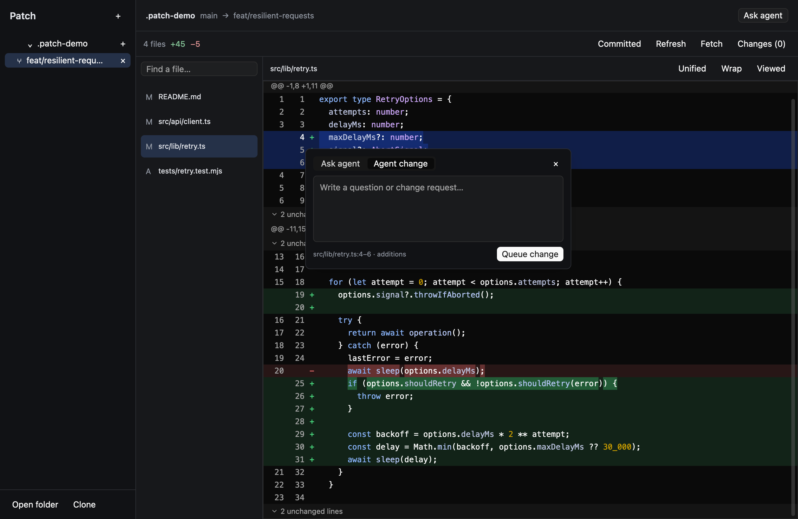

# Patch

A local PR and branch review desk for humans and coding agents. This branch runs a **native GPUI interface** and a CLI.

- [`main`](https://github.com/peterdpong/patch/tree/main): empty README initialization.
- [`electron-mvp`](https://github.com/peterdpong/patch/tree/electron-mvp): original Electron / React / Pierre implementation.
- [`gpui-mvp`](https://github.com/peterdpong/patch/tree/gpui-mvp): GPUI / Rust desktop, sharing the existing Git and agent core.



[Sample discussion view](docs/gpui-threads.png). Offscreen previews omit the system-drawn macOS window controls.

## Run

Tested on Apple Silicon macOS. Install stable Rust, Xcode command-line tools, Node.js 22+, and Git. GitHub PR import also needs an authenticated `gh` CLI. Agent questions and changes need an installed, signed-in Codex or Claude Code CLI.

```sh
git switch gpui-mvp
npm ci
npm start
```

Open a repository directly:

```sh
npm start -- ~/dev/my-repo --base main --head feature/my-change
```

Or create the sample repository:

```sh
npm run demo
npm start -- .patch-demo --base main
```

The first Cargo build downloads and compiles GPUI. Later development builds are incremental.

## Review workflow

1. Use **Open repository** (⌘O or the Projects **+**) to add a local Git folder. Its permanent **Current** entry follows the checked-out branch automatically. Use the **+** beside the project name to search and open additional branches or PRs; **Fetch branches** updates the available remote refs without switching your checkout.
2. Scroll through every changed file in one continuous diff. The file sidebar jumps to a file without replacing the review; filtering searches only those jump links. Each file has its own **Viewed** control. Switch between unified/split views or wrap long lines. **Working tree** toggles local changes in the comparison. **Fetch** updates remotes and imported PR details without changing the checkout.
3. Click and drag across code or line numbers—no Shift needed. On release, a floating prompt opens with **Ask agent / Agent change** tabs above its input. Switching tabs keeps your text and selected code. Shift-select also works. Select one side of the diff for an exact source range.
4. The top **Ask agent** button asks about the whole review. An anchored popover contains the prompt, provider choice, response, and Stop control.
5. **Agent change** queues local feedback. Open **Send changes**, select requests, optionally preview the prompt, and **Send to agent**. The agent edits the current checkout; Patch does not commit or push those edits. Inspect them in **Working tree**.

Project tabs, last-selected files, and local conversations persist across launches. **Threads** collects questions, agent answers, and queued or completed change requests. File badges and inline thread links open the relevant discussion; **View code** returns to its source. Question threads support follow-ups with ⌘Enter. Draft prompts remain available for the current app session. Review controls open compact popovers beside their buttons; click outside or press Escape to dismiss them. There is no permanent agent sidebar.

| Shortcut | Action |
| --- | --- |
| ⌘O | Open repository |
| ⌘K | Ask about the whole review |
| ⌘B | Show / hide the project sidebar |
| ⌘1 / ⌘2 | Select Ask agent / Agent change in the selection prompt |
| Ctrl+Tab / Ctrl+Shift+Tab | Switch prompt tabs while editing |
| ⌘R | Refresh |
| ⌥↓ / ⌥↑ | Next / previous file |
| ⌘⇧V | Toggle viewed |
| ⌘Enter | Submit the prompt or popover |
| Escape | Close the prompt or popover |

The shared title bar reserves space for native macOS window controls. Review headers show the PR title, author, status, description excerpt, and latest commit when available. **Details** opens the full description and commit message. Local branches use their latest commit message. PR metadata is cached on import and refreshed with Fetch.

## Commit comparisons

Use the **commit selector** in the review toolbar. Click one commit, or click one end and **Shift-click** the other to select an inclusive range, then **View diff**. **Full branch diff** returns to the normal branch/PR comparison. The selection stays with its branch tab; feedback, viewed files, and agent conversations are scoped to that comparison.

[Commit picker preview](docs/gpui-commits.png)

History follows the first-parent chain, newest first, with **Load older commits** for longer histories. A merge commit is compared with its first parent. Root commits compare against an empty tree. Switching to **Working tree** clears the commit filter.

```sh
patch commits --repo ~/dev/my-repo
patch diff --commit HEAD~1
patch diff --from HEAD~3 --to HEAD~1
patch open --from HEAD~3 --to HEAD~1
```

Both range endpoints are included. Commit comparisons do not switch branches or modify the checkout. Agent questions use the selected endpoint; applying feedback requires the checkout to match it.

## CLI

After `npm run build:host`, use `node bin/patch.mjs`, or use the native `target/release/patch` executable after `npm run build`.

```sh
node bin/patch.mjs diff ~/dev/my-repo --base main
node bin/patch.mjs ask "What can fail here?" --repo ~/dev/my-repo --base main
node bin/patch.mjs comment "Handle cancellation" --repo ~/dev/my-repo --base main --file src/client.ts --lines 12-18
node bin/patch.mjs apply --repo ~/dev/my-repo --base main --dry-run
node bin/patch.mjs apply --repo ~/dev/my-repo --base main --agent codex
node bin/patch.mjs doctor
```

Use `node bin/patch.mjs help` for all commands. The name `patch` also belongs to a standard Unix utility; use the explicit path unless you deliberately add this app's launcher to PATH.

## macOS app bundle

```sh
npm run bundle
open dist/Patch.app
```

The bundle contains the release GPUI executable, the small bundled JavaScript host/CLI, and a standalone Node runtime. If the build machine uses a dynamically linked Node (such as Homebrew), the bundler downloads Node 24.19.0 from nodejs.org and verifies its published SHA-256 checksum. It has a local ad-hoc signature. Public distribution still needs Developer ID signing/notarization and dependency-license packaging. No Electron, Chromium, React, or webview is used at runtime. A standalone Node runtime is still present; this is **not an all-Rust rewrite**.

`PATCH_BUNDLE_NODE` can supply a standalone Node executable for bundling. `PATCH_NODE_BINARY` overrides Node for development; `PATCH_RESOURCES` overrides the folder containing `host.mjs` and `cli.mjs`. `PATCH_CODEX_PATH` and `PATCH_CLAUDE_PATH` can point to installed agent executables. Their previous `REVUE_*` equivalents also work.

## Architecture

```text
GPUI desktop (Rust)                  CLI (TypeScript / Node)
  project / branch tabs                  terminal diff and review commands
  native virtualized Diff                same Git and agent operations
  selection actions + popovers                     │
             │ private JSONL stdin/stdout           │
             └──────────────┬───────────────────────┘
                    local host / shared core
                    ├── Git + gh subprocesses
                    ├── atomic review / workspace storage
                    └── local Codex / Claude subprocesses
```

GPUI Kit 0.8 provides the native diff, inputs, buttons, focus handling, and text rendering. Git operations run outside the drawing thread. File patches load on demand and stay capped at 2 MB. Request generations prevent older file responses from replacing the current file.

The existing tested core is reused so reviewing, stale-comment validation, worktree isolation, and agent permissions behave like the Electron branch. The host runs only on private pipes and exits when the desktop closes them. Detailed boundaries and migration tradeoffs are in [docs/architecture.md](docs/architecture.md).

## Checks

```sh
npm run check
npm test
cargo fmt --check
cargo test --locked --bin patch
cargo clippy --locked --bin patch -- -D warnings
npm run demo
cargo run --locked --features ui-tests --bin patch-ui-check -- .patch-demo .test-artifacts
```

The last command renders the production view offscreen through Metal on macOS and exercises line selection, scoped/general questions, PR details, saved thread navigation, compact/collapsed layouts, popover dismissal and keyboard handling, draft restoration, split view, wrapping, and file filtering. It saves native render images to `.test-artifacts`. It needs a working GPU context but does not capture or automate your desktop. Host integration tests use temporary Git repositories and fake agent executables; they do not spend model tokens.

## MVP boundaries

- Local repositories and installed agents only; SSH hosts are a future transport extension.
- PR import is supported; hosted review publishing, PR discovery, and automatic commit/push are not implemented.
- Agent turns use installed CLIs. Saved local threads retain questions, requested changes and responses; follow-ups include the previous discussion.
- The project and file lists are conventional scrolling lists; the diff itself is virtualized. Very large repository navigation needs profiling.
- Native window chrome is used. Liquid Glass integration is not part of this MVP.
- Windows and Linux packaging and live authenticated agent inference have not been verified in this build.
